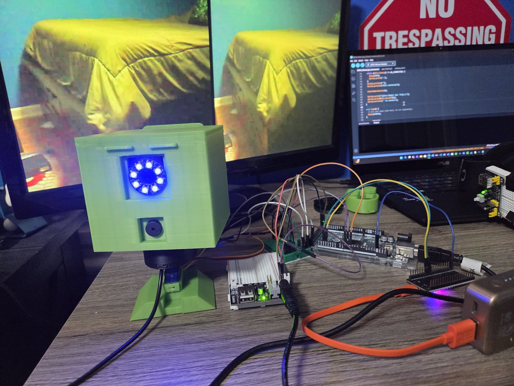
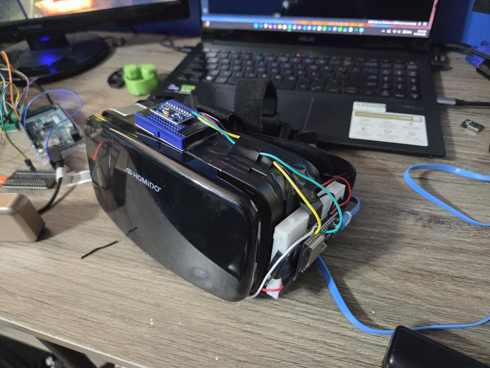
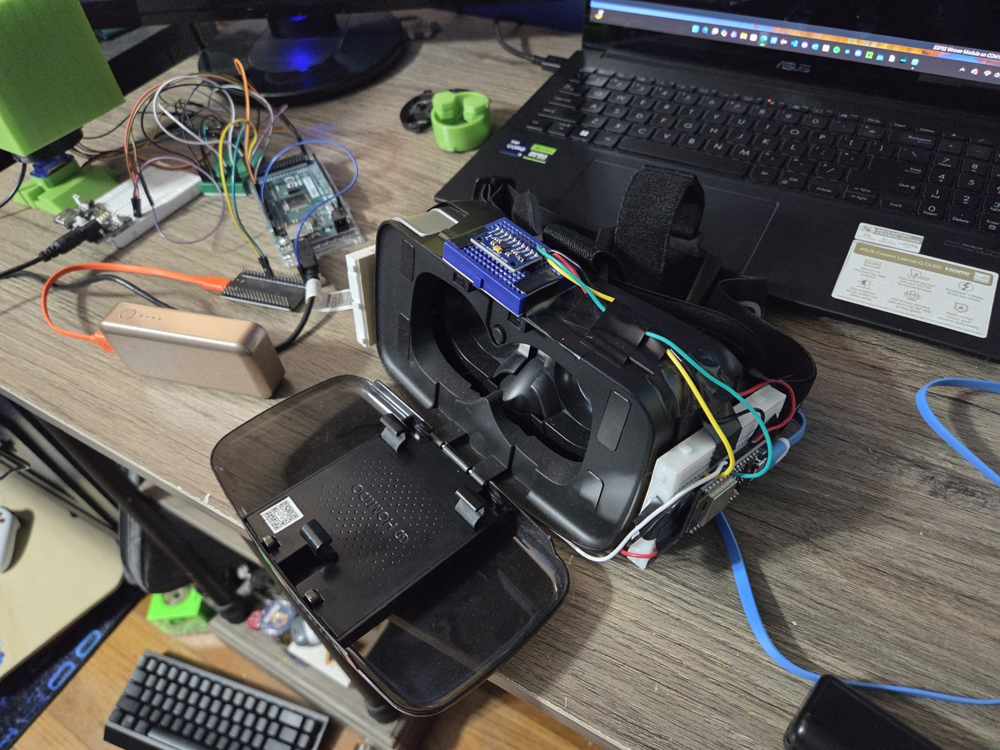
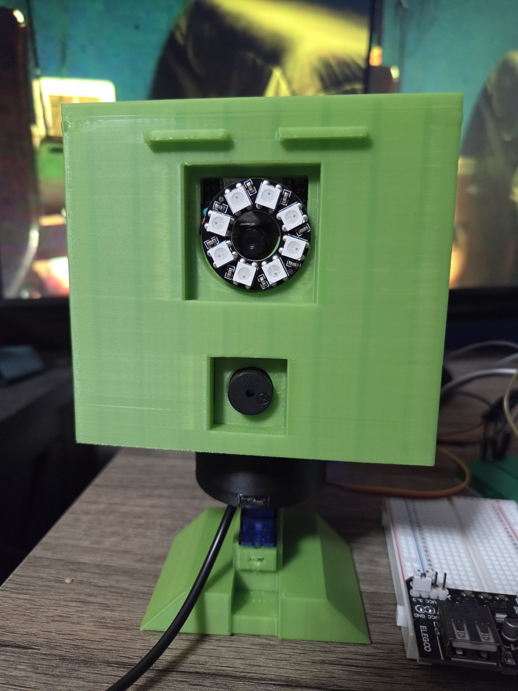

# Head-Tracking VR Telepresence Robot 🤖🥽

<p align="center">
  
</p>

<p align="center"><i>When I turn my head, the robot turns its head. When I look through the headset, I see what the robot sees.</i></p>

<!-- VIDEO: on GitHub, edit this file and drag robot-demo.mp4 onto the empty line below this comment -->


https://github.com/user-attachments/assets/35f59413-c37e-427c-b5a0-f181a8354839


<p align="center"><i>Demo: as I turn the headset, the robot turns with it, and the monitor behind it shows the live split-screen view from the robot's eye.</i></p>

<h2><em>💎 Key Features 💎</em></h2>
<div>
  🟩 <strong>Real-Time Head Tracking</strong><br>
  &emsp;🔸 An MPU6050 gyroscope on top of the headset measures which way I'm looking, and the robot's head follows my movements in real time.<br><br>
</div>
<div>
  🟩 <strong>First-Person VR Video Feed</strong><br>
  &emsp;🔸 An ESP32 camera board sits behind the robot's eye and streams live video. The feed is duplicated side by side so that when my phone is placed in my simple VR headset, it looks like a normal first-person view through the robot's eye.<br><br>
</div>
<div>
  🟩 <strong>Wireless ESP32-to-ESP32 Link</strong><br>
  &emsp;🔸 The headset ESP32 hosts its own WiFi network and streams head angles to a second ESP32 on the robot, so there are no wires between me and the robot and no router is needed.<br><br>
</div>
<div>
  🟩 <strong>Recenter Button & Status LED</strong><br>
  &emsp;🔸 A button on the headset sets "straight ahead" at any time, just like the recenter feature on commercial VR headsets. The onboard LED shows whether the headset is calibrating, waiting for the robot, or streaming.<br><br>
</div>
<div>
  🟩 <strong>Smooth Servo Motion</strong><br>
  &emsp;🔸 The Arduino Mega smooths the incoming angles before moving the servo, so the head glides instead of jittering.<br><br>
</div>
<div>
  🟩 <strong>LED Ring Eye & Sound</strong><br>
  &emsp;🔸 A NeoPixel LED ring surrounds the camera eye and spins red, green, and blue on startup, while a piezo buzzer plays a boot-up sound.<br><br>
</div>
<div>
  🟩 <strong>Fully Custom 3D-Printed Body</strong><br>
  &emsp;🔸 I hand-modeled every 3D-printed part myself, including the head, the removable "JG" back panel, the camera and LED eye mount, the neck with its threaded bolts and nuts, and the servo connector, then printed them all on my Flashforge Adventurer 5M.<br><br>
</div>

<h2><em>✨ Purpose / Inspiration ✨</em></h2>
&emsp;This is my first real robot, built from scratch. The inspiration really just came from I wondered if I could because I saw a video on Instagram of someone controlling one similar at a robotics convention. However, they used a professional headset that I did not have, so I wondered if I could still accomplish the same thing just with less reasources. I wanted to put on a headset, turn my head, and have the robot look around with me so I could see the world from its point of view. I didn't have a real VR headset, so I used an old phone VR viewer (the kind with just two lenses and no electronics) and attached an esp32, gyroscope, and a power module to it. The camera stream from the robots esp32 camera board is split into two side-by-side images so it looks right through the lenses!

&emsp;Building it taught me a lot more than just code. I designed and modeled the entire body myself, went through multiple print iterations to get parts like the neck and servo connector to fit properly, and debugged real hardware problems like power brownouts, wireless reconnection, and gyro drift.

<h2><em>⚙️ How It Works ⚙️</em></h2>
&emsp;The system has three microcontrollers working together, plus a separate camera board.

```
 HEADSET                                   ROBOT
┌───────────────────┐   WiFi (TCP)   ┌───────────────────┐  Serial   ┌──────────────┐
│ MPU6050 gyro      │ ─────────────▶ │ ESP32 receiver    │ ────────▶ │ Arduino Mega │
│ ESP32 transmitter │  head angle    │                   │  115200   │ servo, LEDs, │
│ (WiFi access pt.) │  20x / second  └───────────────────┘           │ buzzer       │
└───────────────────┘                                                └──────────────┘
        ▲
        │ phone in VR viewer shows split-screen video
        │
┌───────────────────┐
│ ESP32 camera      │ ◀── sits behind the robot's eye
│ (on home WiFi)    │
└───────────────────┘
```

&emsp;<b>1. The headset.</b> When the headset powers on, it sits flat on a table while the ESP32 calibrates the MPU6050 by measuring the gyro's built-in error so it can be subtracted later. It then creates its own WiFi network and waits for the robot to connect. Once connected, it reads the gyro's yaw angle and sends it to the robot 20 times per second. Pressing the recenter button saves the current direction as "straight ahead."

<p align="center">
  
  &nbsp;
  
</p>

&emsp;<b>2. The robot's ESP32.</b> This board connects to the headset's WiFi network and forwards every angle it receives to the Arduino Mega over a serial connection.

&emsp;<b>3. The Arduino Mega.</b> The Mega reads each angle, smooths it to remove jitter, maps my head range of -70° to 70° onto the servo's 0° to 180°, and moves the servo that turns the robot's head. It also runs the LED ring eye and the buzzer.

&emsp;<b>4. The camera.</b> An ESP32 camera board behind the robot's eye connects to my home WiFi and hosts a web page with the live video. I connect my phone to the same network, open the board's IP address, and place the phone in the VR viewer. The page shows the stream in two side-by-side boxes, so each lens sees one copy and it looks like a single normal view.

<p align="center">
  
</p>

<h2><em>🔌 Hardware 🔌</em></h2>

| Part | Purpose |
|---|---|
| ESP32 + MPU6050 gyro | Head tracker on the headset |
| ESP32 | Wireless receiver on the robot |
| Arduino Mega 2560 | Main robot controller |
| SG90 servo | Turns the robot's head |
| Freenove ESP32-WROVER (camera) | Live video from the robot's eye |
| NeoPixel LED ring | Animated eye around the camera |
| Piezo buzzer | Startup sounds |
| Pushbutton | Recenter the view |
| USB power bank | Powers the headset |
| Phone VR viewer | Displays the split-screen video |
| Custom 3D-printed parts | Head, neck, back panel, servo connector (all hand-modeled) |


<h2><em>🛠️ Challenges I Solved 🛠️</em></h2>
<div>
  🟩 <strong>Power Brownouts</strong><br>
  &emsp;🔸 The headset worked over USB but not on a 9V battery. The ESP32's WiFi draws large current spikes that made the battery's voltage sag and reset the board, so I switched to a USB power bank.<br><br>
</div>
<div>
  🟩 <strong>Gyro Drift</strong><br>
  &emsp;🔸 A gyro alone can't know where "forward" is and slowly drifts over time, so I added a recenter button and calibrate the sensor while it's perfectly still.<br><br>
</div>
<div>
  🟩 <strong>Mechanical Fit</strong><br>
  &emsp;🔸 The servo connector's spline socket was too loose, so the head wobbled. I measured the socket against the servo's spline and redesigned it for a tight press fit with a stronger screw floor.<br><br>
</div>
